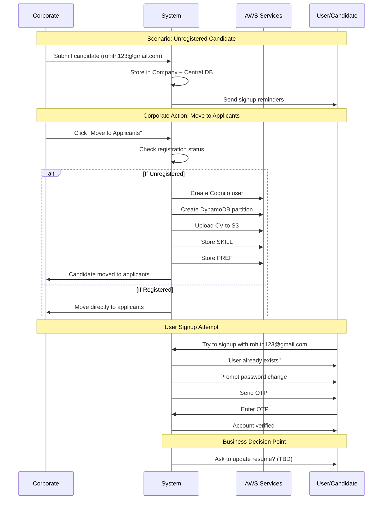

# Candidate Registration & Move to Applicants Flow

## 📋 Flow Scenarios

### 1. Unregistered Candidate Storage

When an unregistered candidate (e.g., `rohith123@gmail.com`) comes from:
- **Agency Candidate Submission**
- **Referral Source Type** 
- **Internal Source Type**

**Actions Taken:**
```
✅ Store in Company Database If its against a company
✅ Store in Central Database  
❌ NO AWS Account Creation (Cognito + DynamoDB)
📧 Send Signup Reminder Messages
```

---

### 2. Corporate "Move to Applicants" Flow

When corporate clicks **"Move to Applicants"** for `rohith123@gmail.com`:

#### Step 1: Registration Check
```mermaid
graph TD
    A[Corporate clicks 'Move to Applicants'] --> B{Check if rohith123@gmail.com is registered}
    B -->|Registered| C[Move applicant directly]
    B -->|Unregistered| D[Create AWS Account]
    D --> E[Create Cognito User]
    D --> F[Create DynamoDB ID# partition]
    D --> G[Upload CV to users/{cognitoUserId}/resumes]
    D --> H[Store details in SKILL# partition]
    D --> I[Store details in PREF# partition]
```

#### Detailed Actions for Unregistered Candidates:

| Action | Description | Location |
|--------|-------------|----------|
| **AWS Account Creation** | Create Cognito user + DynamoDB partition | `AWS Cognito + DynamoDB` |
| **CV Upload** | Upload existing CV | `users/{cognitoUserId}/resumes` |
| **Skills Storage** | Store candidate skills data | `SKILL#` partition |
| **Preferences Storage** | Store candidate preferences | `PREF#` partition |

---

### 3. User Signup Conflict Resolution

When user tries to signup with `rohith123@gmail.com` (already exists):

#### Flow Steps:
```
1. 🚫 Show "User Already Exists" message
2. 🔑 Prompt to change password
3. 📧 Send OTP for email verification  
4. ✅ User enters OTP for verification
5. ❓ Business Decision: Ask to update resume?
```

#### Business Question:
> **Do we ask the candidate to update their resume after OTP verification?**
> 
> **Options:**
> - ✅ **Yes** - Prompt for resume update
> - ❌ **No** - Use existing resume from corporate submission

---

## 🔄 Complete Process Flow



---

## 📊 Data Storage Locations

### Unregistered Candidates
| Data Type | Storage Location | Created When |
|-----------|------------------|--------------|
| Basic Info | Company Database | Initial submission |
| Basic Info | Central Database | Initial submission |
| AWS Account | ❌ Not Created | Until "Move to Applicants" |

### After "Move to Applicants" (Unregistered → Registered)
| Data Type | Storage Location | Path |
|-----------|------------------|------|
| User Account | AWS Cognito | Cognito User Pool |
| User Data | DynamoDB | `ID#` partition |
| Resume/CV | AWS S3 | `users/{cognitoUserId}/resumes` |
| Skills | DynamoDB | `SKILL#` partition |
| Preferences | DynamoDB | `PREF#` partition |

---

## ⚠️ Key Considerations

### Business Decisions Required:
1. **Resume Update Policy**: Should users update resume after OTP verification?
2. **Data Sync**: How to handle conflicts between corporate-submitted data and user-updated data?
3. **Notification Strategy**: What happens to existing reminder messages after account creation?

### Technical Implications:
- **Cognito User Creation**: Automatic password generation vs. user-set password
- **Data Migration**: Moving data from company/central DB to AWS partitions
- **S3 File Management**: CV file naming and organization strategy
- **DynamoDB Partitioning**: Efficient data distribution across SKILL# and PREF# partitions

---

## 🎯 Next Steps

1. **Finalize Business Rules** for resume update requirement
2. **Define Data Migration Strategy** from company DB to AWS
3. **Implement Conflict Resolution** for duplicate signup attempts
4. **Design Notification Management** for existing reminder systems